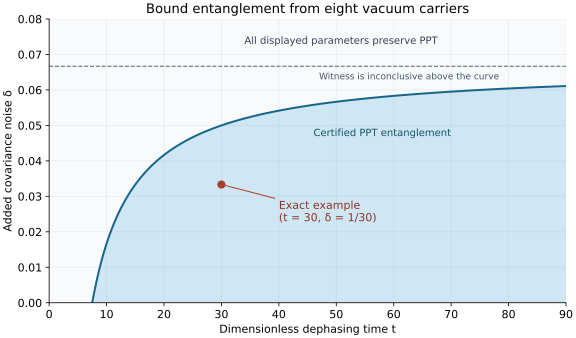

# Gaussian entanglement encoded in pure dephasing

[Scientific route](README.md) · [Dephasing model](model.md) · [Covariance witnesses](covariance-witnesses.md)

## Result and scope

Every finite-mode Gaussian covariance can be encoded in a Hamiltonian-free, time-homogeneous pure-dephasing semigroup on twice as many oscillator modes. A local Gaussian decoder returns the encoded state with a known additive noise. This gives an exact correspondence between Gaussian separability and separability preservation for this dephasing family, and between Gaussian PPT and PPT preservation by its channels.

The restriction is to mutually commuting carrier positions and fixed position-basis populations. The environment supplies quantum correlations; the carrier system starts in a product state. Generic Gaussian reservoir transfer and Gaussian PPT-preserving entangling channels are established results. Their relation to the present constrained embedding is discussed in [Related work](../references/RELATED_WORK.md#gaussian-covariances-and-reservoir-transfer).

[The exact verification script](../verification/verify_transduction.py) checks the canonical completion, channel covariance identities, and rational example without numerical positivity decisions. Its [recorded output](../verification/transduction_verification.json) includes the positivity certificates and exact witness violation.

## Conventions and theorem

Let a centered target Gaussian state have $r=r_A+r_B$ modes and real doubled covariance $G\in\mathbb R^{2r\times2r}$. Order its coordinates by party and, inside each party, in canonical pairs. Thus

$$
[Z_j,Z_k]=i\Omega_{jk},\qquad
\Omega=\Omega_A\oplus\Omega_B,\qquad
\Omega_X=\bigoplus_{j=1}^{r_X}\begin{pmatrix}0&1\\-1&0\end{pmatrix}.
$$

Our doubled covariance is $G_{jk}=\langle\{\Delta Z_j,\Delta Z_k\}\rangle$, so the vacuum has covariance $I$. Physicality is $G+i\Omega\succeq0$. Define

$$
\Omega_{\rm PT}=(-\Omega_A)\oplus\Omega_B.
$$

The target is PPT across $A|B$ exactly when $G+i\Omega_{\rm PT}\succeq0$. This is the usual covariance partial-transpose criterion, expressed by moving the momentum-sign matrix from $G$ onto the symplectic form.

Introduce $d=2r$ carrier oscillators with positions $Q=(Q_1,\ldots,Q_d)^{\mathsf T}$, momenta $P=(P_1,\ldots,P_d)^{\mathsf T}$, and $[Q_j,P_k]=i\delta_{jk}$. There is one carrier position for each target phase-space coordinate. Alice owns the first $2r_A$ carrier modes and Bob the remaining $2r_B$. Set

$$
B=-\Omega,\qquad C_G=G-i\Omega=G+iB,
$$

and use

$$
\mathcal L_G(\rho)=\sum_{jk}(C_G)_{jk}
\left(Q_j\rho Q_k-\tfrac12\{Q_kQ_j,\rho\}\right).
\tag{1}
$$

There is no system Hamiltonian. Time is measured in units of the overall dephasing rate; a rate $\gamma$ can be restored by replacing $C_G$ by $\gamma C_G$ and $t$ everywhere below by $\gamma t$.

**Theorem.** For every physical $G$, (1) defines a completely positive pure-dephasing semigroup $\Phi_t^G$. The following statements hold.

1. From product carrier vacuum, a local Gaussian unitary followed by local discarding produces an $r$-mode state with doubled covariance

   $$
   G+\frac{I}{2t},\qquad t>0.
   \tag{2}
   $$

2. The target Gaussian state is separable if and only if every $\Phi_t^G$ preserves separability. If the target is entangled, product carrier vacuum produces entanglement for every sufficiently large finite $t$.
3. The target is PPT if and only if the semigroup is PPT preserving at all times. Consequently, every Gaussian PPT-entangled target yields PPT-entangled carrier output from product vacuum at a finite time.
4. A stronger fixed-time statement holds when independently squeezed product inputs are allowed: for each fixed $t>0$, $\Phi_t^G$ preserves separability if and only if the target is separable, and it preserves PPT if and only if the target is PPT. Only finite input squeezing is required for a fixed entangled or NPT target.

The decoder is local across the original $A|B$ partition. Its use cannot create the entanglement being certified. It is needed to exhibit the recovered target; it need not be physically implemented to infer that the carrier output before decoding was entangled.

## Exact channel and a finite-time dilation

Since $G$ is real, $G-i\Omega\succeq0$ is the complex conjugate of the physicality condition. In particular, $C_G\succeq0$.

In the joint carrier position basis, the channel is

$$
\langle x|\Phi_t^G(\rho)|y\rangle
=\exp\!\left[-\frac t2(x-y)^{\mathsf T}G(x-y)
-itx^{\mathsf T}\Omega y\right]\rho(x,y).
\tag{3}
$$

This explicitly preserves every joint position-basis population. Multiplying its kernels adds the times, so it is a homogeneous semigroup.

A useful exact dilation also resolves existence issues associated with the unbounded formal $Q_j$. Let an independent reservoir consist of $r$ modes in the centered Gaussian state $\sigma_G$, with coordinates $Z$, covariance $G$, and commutator matrix $\Omega$. At a specified time $t$, define

$$
U_t=\exp\!\left(i\sqrt{2t}\,Q^{\mathsf T}Z\right).
\tag{4}
$$

The two-party generator of this unitary is a sum of commuting local terms, $Q_A^{\mathsf T}Z_A+Q_B^{\mathsf T}Z_B$. Thus $U_t=U_{A,t}\otimes U_{B,t}$ relative to the enlarged carrier-plus-reservoir parties. Gaussian characteristic functions and the Weyl relation give

$$
\operatorname{Tr}_{E}[U_t(\rho\otimes\sigma_G)U_t^\dagger]=\Phi_t^G(\rho).
\tag{5}
$$

Explicitly, cyclicity of the reservoir trace combines the two conditional displacements into a displacement by $\sqrt{2t}(x-y)$, together with the Weyl phase $\exp[-itx^{\mathsf T}\Omega y]$. Its Gaussian characteristic function supplies the real exponential in (3).

Equation (4) is a dilation for each channel at a chosen time. It does **not** assert that one finite reservoir, reused without resetting and evolving under a time-independent interaction for physical time $t$, realizes the whole semigroup. A collision or Gaussian white-noise realization uses fresh reservoir degrees of freedom when composing time steps. The coefficient $\sqrt t$ in the finite-time dilation is part of that distinction.

The exact Heisenberg output variables are

$$
Q_{\rm out}=Q,\qquad
P_{\rm out}=P-t\Omega Q+\sqrt{2t}\,Z.
\tag{6}
$$

For example, the nested commutator expansion of $U_t^\dagger P U_t$ terminates after the second commutator. The first term is $+\sqrt{2t}Z$; the second is $-t\Omega Q$. This sign agrees with $B=-\Omega$.

The Gaussian-channel matrices, in carrier ordering $(Q,P)$, are therefore

$$
A_t=\begin{pmatrix}I&0\\-t\Omega&I\end{pmatrix},\qquad
Y_t=\begin{pmatrix}0&0\\0&2tG\end{pmatrix}.
\tag{7}
$$

From carrier vacuum their output covariance is

$$
V_t=\begin{pmatrix}
I&t\Omega\\-t\Omega&I+2tG+t^2I
\end{pmatrix}.
\tag{8}
$$

Equivalently, for general antisymmetric $B$, the familiar expression is $V_t=\left(\begin{smallmatrix}I&-tB\\tB&I+2tG-t^2B^2\end{smallmatrix}\right)$. The finite-time dilation makes (7) a genuine channel even though its deterministic drift alone is not symplectic.

## Local canonical extraction and completion

Define the following $d$ output observables on the carriers:

$$
X=\frac{P+t\Omega Q}{\sqrt{2t}}
=\frac{P-tBQ}{\sqrt{2t}}.
\tag{9}
$$

They are actual canonical coordinates:

$$
[X_j,X_k]=i\Omega_{jk}.
\tag{10}
$$

The antisymmetry is essential. Both mixed terms in the commutator contribute with the same sign. Formula (6) gives the particularly transparent dilation identity

$$
X_{\rm out}=Z+\frac{P_{\rm in}}{\sqrt{2t}}.
\tag{11}
$$

Since the input carrier momenta commute and have doubled covariance $I$, the reduced Gaussian state of $X$ has covariance (2).

To establish that these observables define a local tensor-factor subsystem, not merely a formal set of linear combinations, introduce

$$
Y=\frac{P-t\Omega Q}{\sqrt{2t}}.
$$

Direct commutation gives

$$
[Y_j,Y_k]=-i\Omega_{jk},\qquad [X_j,Y_k]=0.
$$

Let $D=\bigoplus_{j=1}^{r}\operatorname{diag}(1,-1)$, which acts separately within each party and satisfies $D\Omega D=-\Omega$. Then $Y'=DY$ has canonical commutator $i\Omega$. The full real transformation is

$$
\begin{pmatrix}X\\Y'\end{pmatrix}
=\frac1{\sqrt{2t}}
\begin{pmatrix}t\Omega&I\\-tD\Omega&D\end{pmatrix}
\begin{pmatrix}Q\\P\end{pmatrix}.
\tag{12}
$$

It is invertible and takes the carrier canonical form to $\Omega\oplus\Omega$. All its entries connecting Alice to Bob vanish after party ordering. It is therefore implemented by local Gaussian unitaries, after which the $Y'$ modes may be discarded locally.

There is also a simple optical decomposition per target canonical pair. Label its two carrier modes by 1 and 2. Squeeze both carriers as $Q_j\mapsto\sqrt t\,Q_j$, $P_j\mapsto P_j/\sqrt t$; Fourier rotate carrier 1; then apply a balanced beamsplitter to the pair. The plus output is

$$
X_q=\frac{P_1+tQ_2}{\sqrt{2t}},\qquad
X_p=\frac{P_2-tQ_1}{\sqrt{2t}},
$$

and the minus output is the canonical complement. Both carriers belong to the same party, so this decoder needs no interparty interaction.

## Separability: both directions

The covariance characterization of Gaussian separability, summarized in [the witness framework](covariance-witnesses.md), is due to Werner and Wolf: $G$ is the covariance of a separable Gaussian state exactly when there exist physical local covariances $G_A,G_B$ with

$$
G\succeq G_A\oplus G_B.
\tag{13}
$$

For such a target, let $N=G-(G_A\oplus G_B)\succeq0$. Then the coefficient matrix decomposes as

$$
C_G=(G_A-i\Omega_A)\oplus(G_B-i\Omega_B)+N.
\tag{14}
$$

The first part generates local channels. The real positive matrix $N$ generates correlated classical Gaussian phase kicks, each of which factorizes into a unitary on Alice and a unitary on Bob. All these dephasing superoperators commute because they are polynomials in mutually commuting left and right multiplication by the $Q_j$. Their channel product is separability preserving on arbitrary inputs that are separable across $A|B$, including non-Gaussian inputs. Alternatively, (5) gives an immediate proof: a separable reservoir state, local unitaries, and local traces cannot create cross-party entanglement.

For the converse, an entangled Gaussian covariance admits a positive covariance witness $W\succeq0$ with

$$
\Delta=\beta_{\rm sep}(W)-\operatorname{Tr}(WG)>0,
\qquad
\beta_{\rm sep}(W)=f(W_A,\Omega_A)+f(W_B,\Omega_B),
\tag{15}
$$

where $f(M,\Omega)=\operatorname{Tr}|i\sqrt M\Omega\sqrt M|$. The [covariance-witness theorem](covariance-witnesses.md#the-witness-bound) proves this lower bound for every separable state with finite second moments, including non-Gaussian states. Completeness for Gaussian covariances follows by separating the closed convex set (13); its upward closure forces the separating weight to be positive semidefinite. Closedness can be seen by taking a convergent sequence of upper covariances in (13): the dominated local covariances have bounded subsequences, whose limits remain physical and satisfy (13).

On the decoded output,

$$
\operatorname{Tr}\left[W\left(G+\frac I{2t}\right)\right]
=\operatorname{Tr}(WG)+\frac{\operatorname{Tr}W}{2t}.
$$

Thus the carrier state is entangled whenever

$$
t>\frac{\operatorname{Tr}W}{2\Delta}.
\tag{16}
$$

This is a finite-time certificate; it does not rely on claiming entanglement only in an asymptotic limit. The decoded state also converges in trace norm to the target as $t\to\infty$, since it is the target passed through an additive Gaussian displacement channel whose noise tends to zero.

At any preassigned $t>0$, use independent pure squeezed carrier inputs with doubled covariances $V_Q=s^{-1}I$, $V_P=sI$, $s>0$. The same decoder produces $G+sI/(2t)$, so choosing $s<2t\Delta/\operatorname{Tr}W$ yields entanglement at that time. The initial carrier state remains a product over individual modes and has finite energy for every strictly positive $s$. This proves the fixed-time separability statement.

## PPT: exact covariance-to-generator correspondence

With group indices ordered by party, partial transpose changes the dissipative coefficient matrix to

$$
C_T=\begin{pmatrix}
G_{AA}+i\Omega_A&-G_{AB}\\
-G_{BA}&G_{BB}-i\Omega_B
\end{pmatrix}.
\tag{17}
$$

The usual imaginary cross-party Hamiltonian in the transpose-conjugated generator is absent here because $B_{AB}=0$. Let $S=(-I_A)\oplus I_B$. Then

$$
SC_TS=G-i\Omega_{\rm PT}.
\tag{18}
$$

Consequently $C_T\succeq0$ exactly when the target is PPT. The [transpose-conjugated generator criterion](model.md#a-sufficient-all-time-ppt-condition) gives complete PPT preservation at every time. One can also read this directly from the local dilation: a PPT reservoir combined with a PPT carrier input remains PPT under the enlarged local unitaries and local reservoir trace.

If the target is NPT, $G+i\Omega_{\rm PT}$ has a strictly negative eigenvalue. Adding sufficiently small positive scalar noise preserves that negative eigenvalue. Formula (2), or its squeezed-input version, then gives an NPT decoded output from a product input, which would be impossible if the carrier channel preserved PPT. This proves both the all-time and fixed-time converses.

Combining the two characterizations, Gaussian PPT entanglement maps into dephasing channels that preserve PPT yet create entanglement. Gaussian separability testing is therefore embedded exactly into separability preservation for this constrained family; the PPT cone has its corresponding exact embedding as well.

## An explicit integer example

Take the four-mode covariance from Eq. (9) of [Werner and Wolf, PRL 86, 3658 (2001)](https://arxiv.org/pdf/quant-ph/0009118). The coordinate order is exactly

$$
(q_1,p_1,q_2,p_2,q_3,p_3,q_4,p_4),\quad A=(1,2),\quad B=(3,4):
$$

$$
G_0=\begin{pmatrix}
2&0&0&0&1&0&0&0\\
0&1&0&0&0&0&0&-1\\
0&0&2&0&0&0&-1&0\\
0&0&0&1&0&-1&0&0\\
1&0&0&0&2&0&0&0\\
0&0&0&-1&0&4&0&0\\
0&0&-1&0&0&0&2&0\\
0&-1&0&0&0&0&0&4
\end{pmatrix}.
\tag{19}
$$

Both $G_0+i\Omega$ and $G_0+i\Omega_{\rm PT}$ have characteristic polynomial

$$
\lambda^2(\lambda-3)^2(\lambda^2-6\lambda+6)^2.
$$

Their eigenvalues are $0,3,3-\sqrt3,3+\sqrt3$, each twice, so both are positive semidefinite. Adding $\delta I$, with $\delta>0$, makes both strict.

A sparse witness is the sum of doubled variances of

$$
2q_1-q_3,\qquad 2q_2+q_4,\qquad
3p_1+p_4,\qquad 3p_2+p_3.
\tag{20}
$$

Write its weight as $W=F^{\mathsf T}F$, with the four rows of $F$ given by these coefficients. Then

$$
\operatorname{Tr}(WG_0)=26,\qquad\operatorname{Tr}W=30.
\tag{21}
$$

Every $A|B$-separable state satisfies a lower bound of 28. To see it without a numerical symplectic calculation, the local Alice block of $W$ is $\operatorname{diag}(4,9,4,9)$. Each of Alice's two modes contributes at least $2\sqrt{4\cdot9}=12$ by local uncertainty. Bob's block is $I_4$, contributing at least 2 per mode. The total is $24+4=28$. Positive covariance from mixing product-state means cannot decrease this bound.

Set $G_\delta=G_0+\delta I$, and build $C=G_\delta-i\Omega$ on eight carrier oscillators, four per party. Product carrier vacuum gives decoded witness score

$$
26+30\delta+\frac{15}{t}.
\tag{22}
$$

It is strictly below 28 whenever

$$
\delta\geq0,\qquad \delta+\frac1{2t}<\frac1{15}.
\tag{23}
$$

This is a sufficient witnessed region, not a claim of the exact separability boundary of $G_0+\delta I$.

The shaded region is certified by this particular witness. All displayed parameters preserve PPT; the unshaded region is left undecided by the inequality. [The figure generator](../verification/plot_witness_region.py) evaluates the analytic boundary directly.

One entirely rational benchmark is

$$
\boxed{\delta=\frac1{30},\qquad t=30.}
$$

Both $C$ and $C_T$ are then strictly positive. Their positive leading principal minors are provided in [the exact verification output](../verification/transduction_verification.json). The witness score is exactly $55/2=27.5<28$, with gap $1/2$. Thus eight individually uncorrelated oscillator vacua evolve under Hamiltonian-free pure dephasing to a PPT-entangled state. The local decoder only exposes entanglement already present in that state.

The [four-carrier construction](four-mode-certificate.md) uses fewer physical modes and gives the smaller certified finite-qubit instance. The integer example here exposes the general mechanism with simpler exact algebra. Its target Gaussian bound-entangled covariance is the established Werner–Wolf example.

## Resources, interpretation, and limitations

The finite-time dilation supplies the encoded Gaussian state as a reservoir resource. For PPT-entangled $G$, that resource is itself PPT entangled across the reservoir parties. Thus no entanglement monotone is violated: entanglement is transferred from the quantum-correlated reservoir into initially uncorrelated carriers. An implementation using independent vacuum reservoirs instead would need collective nonlocal coupling operators obtained by factoring $C$. The theorem does not make either resource free.

The original dephasing generator has no Hamiltonian and conserves carrier position populations. Its physical reservoir interaction in a dilation is an interaction Hamiltonian, as is usual for microscopic implementations of dissipative dynamics. These are distinct levels of description. Classical correlated Gaussian phase noise alone cannot implement the entangled target cases, as the decomposition obstruction (14) makes precise.

At finite $t$, the recovered covariance is $G+I/(2t)$. Exact recovery is asymptotic. The decoder depends on time and uses squeezing of magnitude $\tfrac12|\log t|$ per carrier in the stated convention, plus local rotations and balanced beamsplitters. For vacuum input the total carrier excitation relative to its uncoupled oscillator vacua is

$$
\langle N_{\rm carriers}\rangle
=\frac{\operatorname{Tr}V_t-2d}{4}
=\frac t2\operatorname{Tr}G+\frac{dt^2}{4}.
\tag{24}
$$

For the rational eight-carrier benchmark it equals 2074. This is an exact finite-energy mathematical example; no experimental cost optimum or laboratory implementation is claimed. A squeezed-input proof of the fixed-time statement additionally charges initial energy $d(s+s^{-1}-2)/4$.

For entanglement certification, one can evaluate the pulled-back variance witness on carrier observables, so physically carrying out the decoder is unnecessary. For target-state preparation, the decoder operations and their resources must be included.

## Relation to prior constructions

The pure-dephasing generator and its sufficient partial-transpose test come from the correlated-dephasing framework of [Seif, Wang and Clerk](../references/RELATED_WORK.md#correlated-dephasing-and-the-open-question). The present correspondence exposes a PPT-entangled part of that dynamical class which a negativity test cannot detect.

The covariance separability criterion and integer target are due to Werner and Wolf. Dissipative Gaussian reservoir transfer is treated, for example, by Yamamoto's input-field-to-memory construction; Gaussian channels capable of creating bound entanglement are treated by Rau and colleagues' doubly parametric transducers. The [detailed comparison](../references/RELATED_WORK.md#gaussian-covariances-and-reservoir-transfer) distinguishes those results from the commuting-position, population-preserving semigroup and its exact separability/PPT correspondence. The microscopic resource interpretation is shared with reservoir engineering: quantum correlations are transferred into the system, not obtained from a classical correlated phase process.
